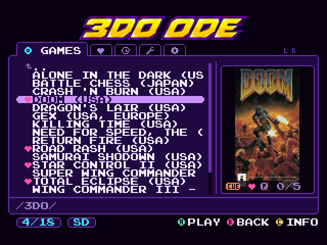
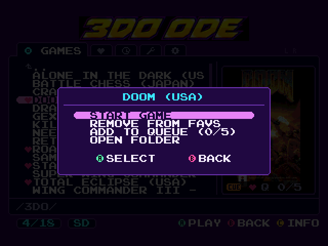
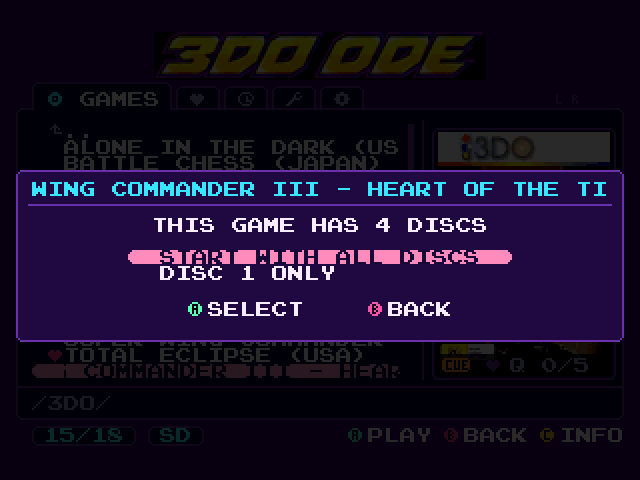
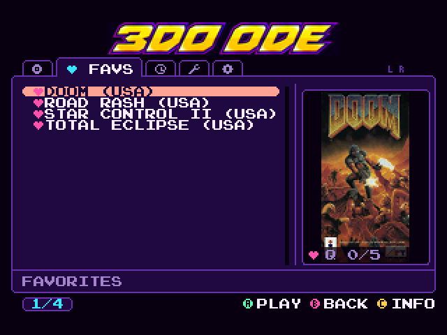
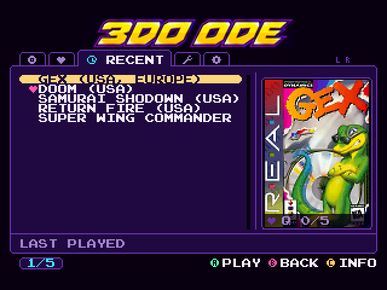
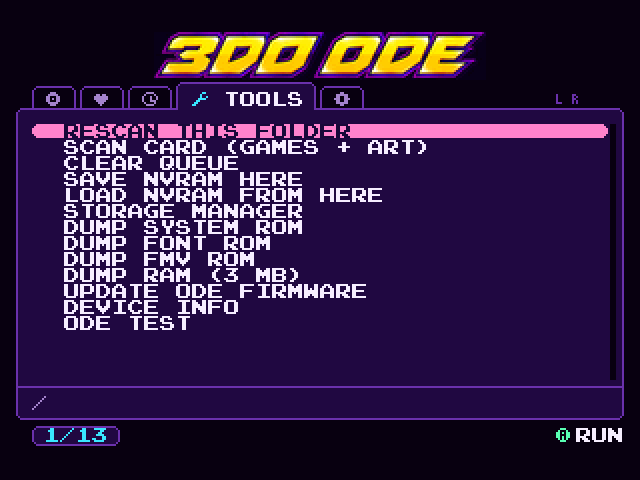
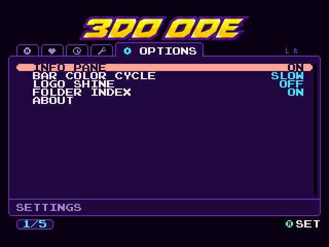
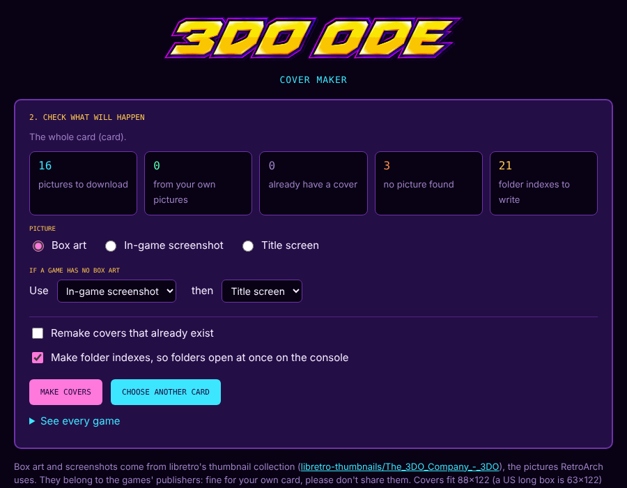
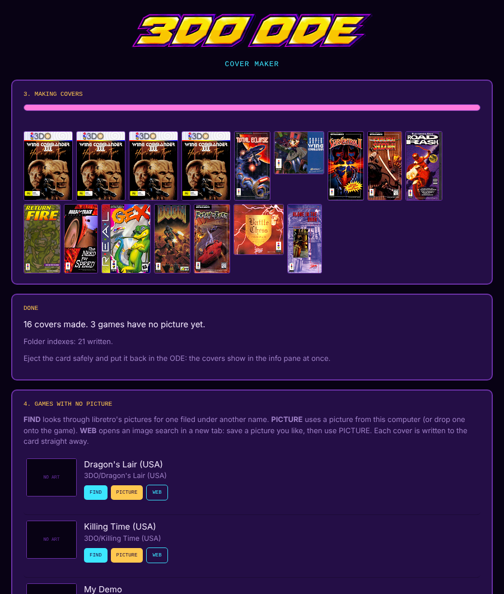

# 3DO ODE Menu

A new menu for 3DO optical drive emulators: Fixel's FZ-1 ODE and most clones. It's a replacement `boot.iso`: copy it to your card in place of the stock
one and everything else (the ODE driver, Storage Manager, firmware updates) works as before.

It works with Fixel's ODE and has been tested on one clone. Most clones should work too, but there are too many
to check them all; if yours has trouble, see [Clones](#clones).

Tabs across the top, a game list on the left and an info pane with the box art on the right. The menu's design and
artwork are mine and not for reuse in other projects; see [NOTICE.md](NOTICE.md).

<p align="center"></p>

## Features

- Tabs for **Games**, **Favs**, **Recent**, **Tools** and **Options**
- Box art or screenshots for each game (see [Cover art](#cover-art))
- Folders and games sorted the way you'd expect, with `Disc 2` before `Disc 10`
- A game kept in its own folder (`Doom/Doom.cue` + `.bin`) shows up as the game itself, no need to open the folder
- Multi-disc games: start disc 1 and the menu offers to queue the rest
- Favorites, recently played and a play queue
- Big folders open quickly after the first visit
- Hold up/down to scroll (it speeds up), L/R to switch tabs, left/right to jump by letter
- All the original tools: NVRAM save and load, ROM and RAM dumps, ODE firmware update, Storage Manager

The version is the build date, shown under Options > About.

## Screenshots

<table>
  <tr>
    <td><br>Press A on a game: start it, favorite it or queue it</td>
    <td><br>Start disc 1 of a multi-disc game and the menu offers the rest</td>
  </tr>
  <tr>
    <td><br>Favorites</td>
    <td><br>Recently played</td>
  </tr>
  <tr>
    <td><br>Tools</td>
    <td><br>Options</td>
  </tr>
</table>

## Install

1. Keep a copy of your original `boot.iso`.
2. Download `boot.iso` from [Releases](../../releases) and copy it to the root of your microSD card (or USB drive),
   replacing the old one.

To go back, copy the original `boot.iso` back.

## Controls

| Button | What it does |
|---|---|
| A | Open a folder, or open the game menu (start, favorite, queue) |
| B | Up a folder, or back to Games from the other tabs |
| C | Show or hide the info pane |
| P | Start the queue, or the selected game if the queue is empty |
| L / R | Previous / next tab |
| Up / Down | Move (hold to scroll faster) |
| Left / Right | Jump to the previous / next letter; change a setting in Options |

## Cover art

The menu shows a small `.img` picture for each game. It doesn't download anything or convert pictures while
you browse (that's what keeps it quick), so the covers have to be made first. Pick whichever is easiest:

- **Cover Maker (web page)**: open `tools/covermaker.html` (also attached to each release) in Chrome or Edge on
  your computer, choose your SD
  card and press MAKE COVERS. It finds your games, grabs box art (or screenshots, or title screens, your choice)
  from the [libretro thumbnail collection](https://github.com/libretro-thumbnails/The_3DO_Company_-_3DO) and
  writes the covers straight to the card. For games it can't match, you can search under another name or use a
  picture of your own. Firefox and Safari can't write to a folder, so use the Python version there. Brave works
  after turning on `brave://flags/#file-system-access-api`.
- **Cover Maker (Python)**: `python3 tools/covermaker.py`, the same thing for any computer with Python 3 and Pillow
  (`pip install pillow`). Run it with `--help` for the options.
- **Your own pictures**: put a `.jpg` or `.png` named after the game next to it (`Doom (USA).jpg`), or in a game's
  folder named after the folder, then run either Cover Maker, or TOOLS > SCAN CARD on the console. The console
  is slow at this (about 5 seconds a cover), so it's best for a few new games.

Both Cover Makers also save a folder index in each folder, so even the first visit on the console is quick.

<table>
  <tr>
    <td><br>Choose box art, screenshots or title screens, and what to use when a game has none</td>
    <td><br>The covers it made, and the games it couldn't match</td>
  </tr>
</table>

The pictures belong to the games' publishers. Fine for your own card, but please don't share them.

## Files the menu adds to your card

All of these are hidden from the menu (names starting with `_`) and safe to delete:

- `_odemenu.idx` in each folder: the saved folder listing (Options > Folder Index turns it off)
- `_cover.img` in a game's folder, or `_art/<game>.img` next to loose game files: the covers
- `_odemenu.fav`, `_odemenu.rec`, `_odemenu.opt` in the root: favorites, recently played and settings

## Known limits

- The first visit to a really big folder is slow. That's the ODE firmware, which re-reads the folder from the top
  for every entry. Every visit after that is quick, and the Cover Makers can make the indexes ahead of time.
- Names show in capitals, accents are dropped and Japanese characters show as `?` (the font has no lower case).
- Up to 4,096 entries per folder.

## Clones

Clone ODEs run Fixel's firmware or their own copy of it, and some answer a few requests differently. The menu
allows for the differences seen so far: one clone numbers its files differently, and the menu now reads the numbers
the ODE gives it instead of assuming them. If a game won't start on your clone, or the menu says a game is no
longer on the card, open the folder with your games, run **Tools > ODE Test** and post photos of both pages in an
issue. That shows how your ODE answers, which is usually enough to fix it.

## Building

You'll need the [3do-devkit](https://github.com/trapexit/3do-devkit) and a copy of the original V5 `boot.iso`
(the new disc is built from it).

```sh
DEVKIT=~/3do-devkit ./build_3do.sh                   # -> build/3do/LaunchMe
./make_disc.sh original/boot.iso out/boot.iso        # -> signed boot.iso
host/build_host.sh && tests/run_tests.sh             # tests on a PC, with a simulated ODE
```

`tools/mkui.py` rebuilds the font, icons and menu logo (it needs the author's art sources), and
`tools/mkbanner.py` the boot banner (only needed when the art changes).
[docs/NOTES.md](docs/NOTES.md) has the technical notes: how the folder index works, what was learned on hardware,
and the fixes to the original tools.

## Credits

- Menu: Todd Gill / Retro Frog
- FZ-1 ODE and the original menu: Fixel
- Built from the reconstruction of Fixel's menu at
  [yesmorepain/fixel-3do-fz1-ode-menu-decomp](https://github.com/yesmorepain/fixel-3do-fz1-ode-menu-decomp)
- Font: Press Start 2P (c) 2011 Cody Boisclair, SIL Open Font License (`OFL.txt` is on the disc)
- PNG decoding: [tinf](https://github.com/jibsen/tinf) by Joergen Ibsen (zlib license); JPG decoding:
  [picojpeg](https://github.com/richgel999/picojpeg) by Rich Geldreich (public domain)
- Cover pictures: the [libretro-thumbnails](https://github.com/libretro-thumbnails/The_3DO_Company_-_3DO) project

## License

The tools, tests and docs are MIT licensed (see [LICENSE](LICENSE)): both Cover Makers, `mkart.py`, the PC test
harness and simulator.

**All rights reserved, not for reuse in other projects without permission** (see [NOTICE.md](NOTICE.md)):

- the menu's design: its layout, look and behavior;
- `src/`, the menu itself (it also started from the reconstruction of Fixel's menu, which doesn't have a license
  yet; Fixel has said he means to open-source the menu);
- the artwork: icons, badges, buttons, the 3DO ODE logo and boot banner, and `tools/mkui.py`, which draws them.

`boot.iso` isn't in this repository: it contains files from Fixel's disc and the 3DO SDK. The font (Press Start 2P,
SIL Open Font License), tinf (zlib) and picojpeg (public domain) keep their own licenses. Cover pictures the tools
download, and the box art in the screenshots in `docs/images/`, belong to the games' publishers.
